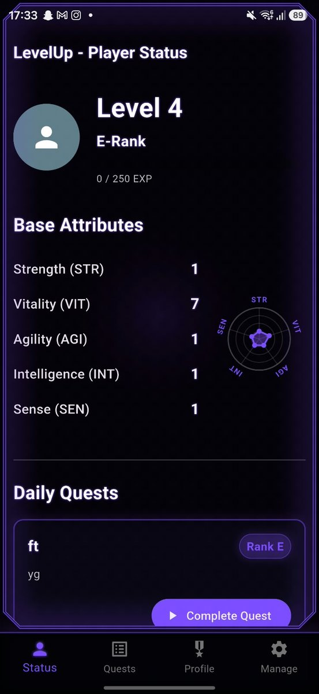
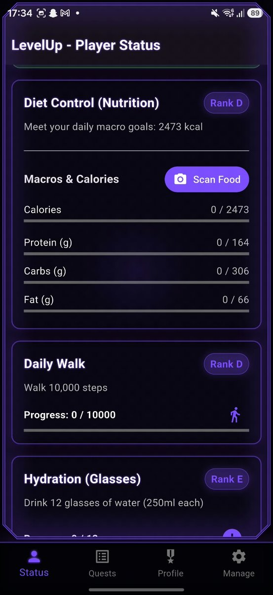
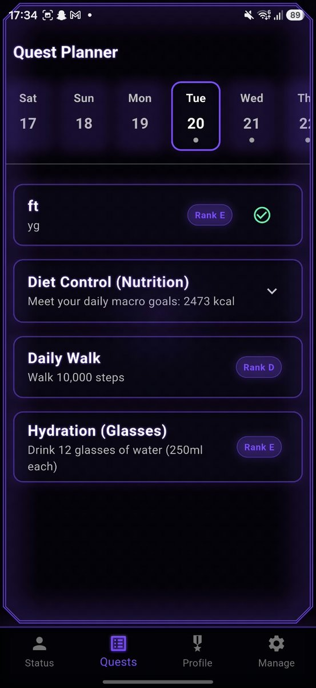
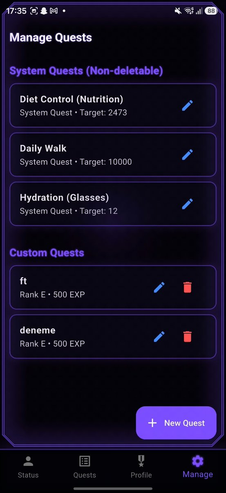
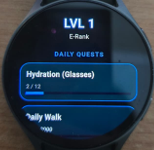

# ⚔️ LevelUp — Gamified Habit & Fitness Tracker

**LevelUp** turns your daily tasks into RPG quests. Inspired by the "System" UI from *Solo Leveling*, it rewards completed habits with XP, levels and stat points, tracks your steps automatically, and estimates the calories of your meals from a photo using Google Gemini. It runs on **Android** with a **Wear OS** companion app.

<p align="center">
  
  
  
  
</p>
<p align="center">
  
  <br><em>Wear OS companion</em>
</p>

## Features

### 🎮 RPG progression
- **Quests with difficulty ranks (E → S)** that grant XP and boost one of five stats: Strength, Vitality, Agility, Intelligence, Sense
- **Level-up system** with increasing XP requirements and a level-up dialog
- **Stat radar chart** that visualizes your character build
- **Hunter-rank achievements (E → SSS)** unlocked as you level up, plus a full quest completion history

### ✅ Flexible quest system
- One-time, **recurring** (on selected weekdays) and **progress-based** quests (e.g. "10,000 steps", "8 glasses of water")
- **Chain quests** made of sub-quests
- **End-of-day evaluated limits** (e.g. "max 2 hours of screen time")
- Daily planner and automatic daily resets

### 🏃 Health & AI
- **Automatic step tracking** via the device pedometer and **Health Connect**
- **AI food scanner:** take a photo of a meal → Gemini returns estimated calories, protein, carbs and fat as structured JSON (with model fallback)

### ☁️ Sync & delivery
- **Offline-first** local storage with Hive
- **Google Sign-In** with Firebase Auth, cloud backup and restore on **Cloud Firestore**, plus local JSON backups
- **Wear OS companion** that syncs quests and progress with the phone
- **In-app update checker** that compares the installed version with `version.json` and downloads the new APK from GitHub Releases

## Tech Stack

| Area | Tools |
|---|---|
| Framework | Flutter (Dart 3) |
| State management | Provider |
| Local storage | Hive, SharedPreferences |
| Backend | Firebase Auth, Cloud Firestore |
| AI | Google Gemini API (multimodal, JSON output) |
| Device | pedometer, health (Health Connect), flutter_wear_os_connectivity |
| UI | fl_chart, custom "System" theme |
| Networking | Dio |

## Project Structure

```
lib/
├── models/        # Quest, SubQuest, PlayerStats, Achievement (Hive type adapters)
├── providers/     # PlayerStateManager: XP, levels, quests, step tracking
├── services/      # auth, cloud sync, local DB, Wear OS sync, AI nutrition, update checks
├── screens/       # home, quest board, planner, profile, achievements, history, wear_os/
├── widgets/       # stat radar chart, level-up & update dialogs, animated background
└── theme/         # dark "System" theme
```

## Getting Started

### Prerequisites
- Flutter SDK (Dart ≥ 3.11)
- An Android device or emulator (Wear OS emulator optional)
- A Firebase project with Authentication (Google) and Firestore enabled

### Setup
```bash
git clone https://github.com/AlperSayginEtci/level_up.git
cd level_up
flutter pub get
flutterfire configure        # generates your own lib/firebase_options.dart
flutter run
```

To use the AI food scanner, enter your own [Gemini API key](https://aistudio.google.com/app/apikey) on the Profile screen. The key is stored locally on the device.

### Download
Prebuilt APKs are published on the [Releases](https://github.com/AlperSayginEtci/level_up/releases) page.

## Roadmap
- [ ] Friends and leaderboards
- [ ] Home screen widget
- [ ] iOS / watchOS support
